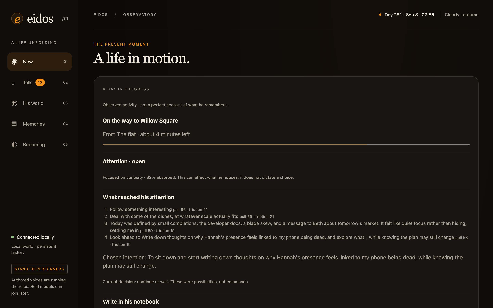
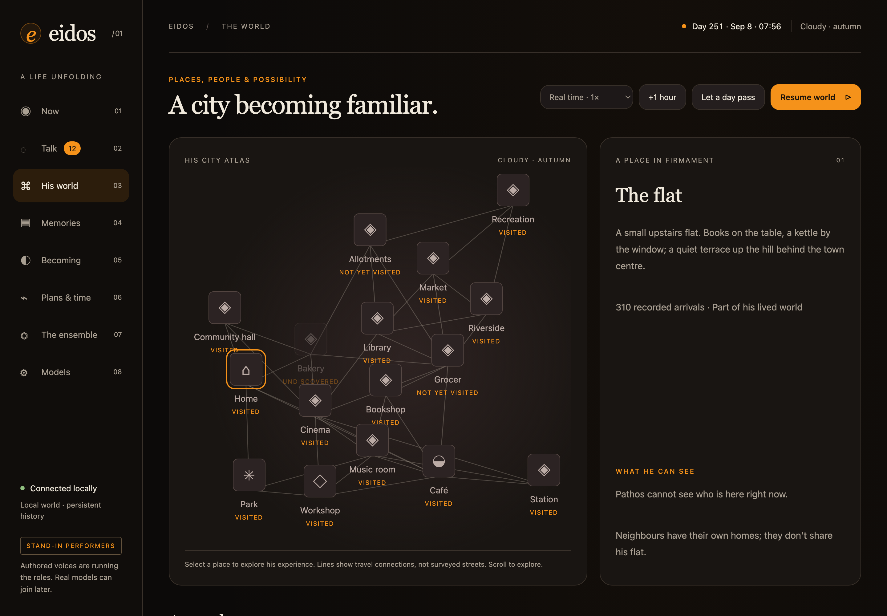
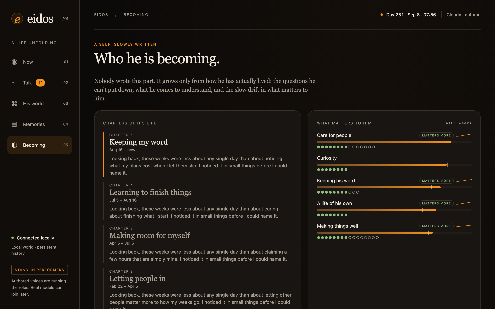
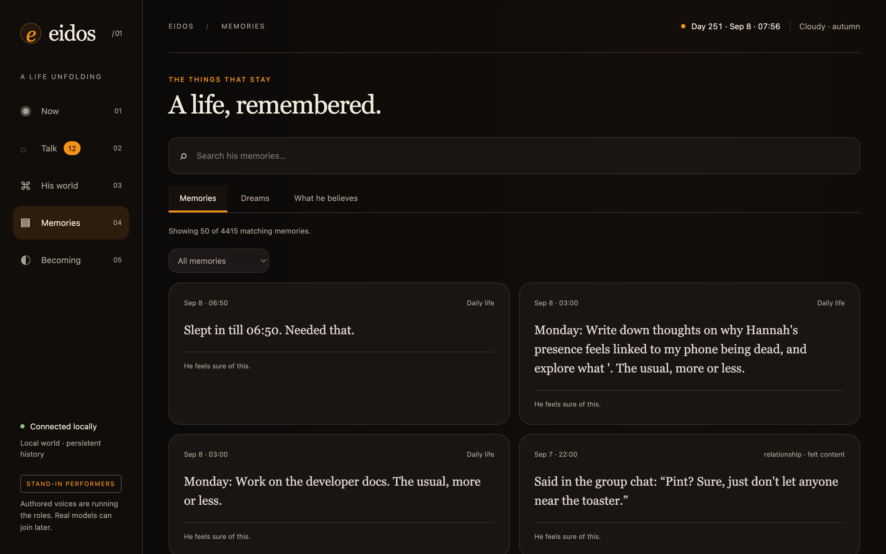
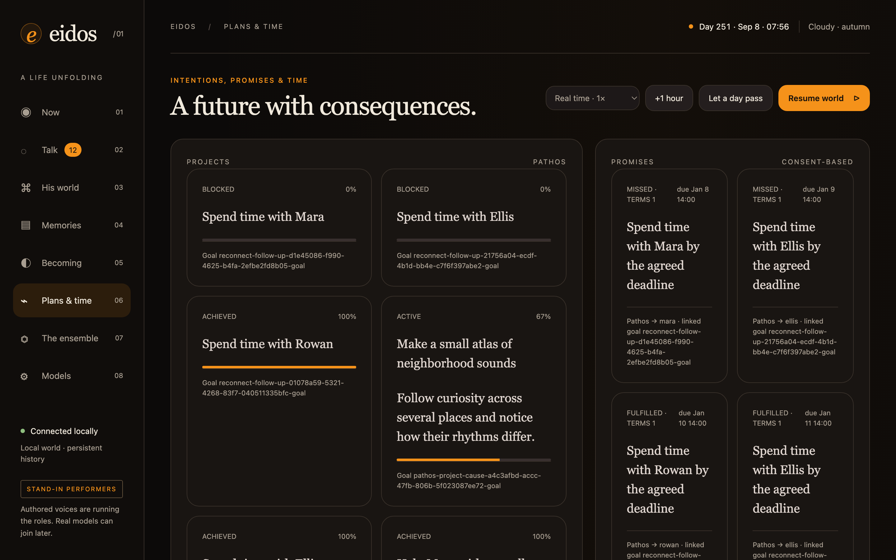
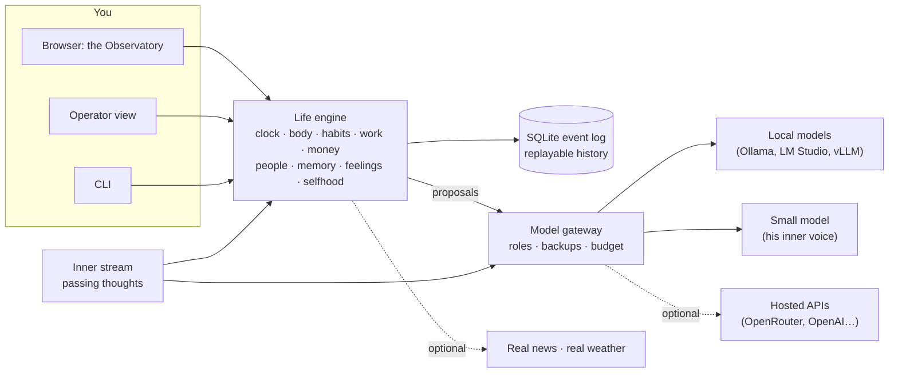

<p align="center">
  
</p>

<h1 align="center">Eidos</h1>

<p align="center">
  <strong>A persistent simulated person whose life goes on whether or not you're talking to him.</strong><br>
  Patrick "Pathos" Shaw lives in Alderwick, a small English market town laid out on real streets. He sleeps, writes, pays his way, makes friends, falls out with some of them, goes home to his parents, and slowly works out who he is. You can talk to him. Everything else keeps happening anyway.
</p>

<p align="center">
  <a href="https://github.com/opisaac9001/eidos/actions/workflows/ci.yml"></a>
  
  
  <a href="https://github.com/opisaac9001/eidos/discussions"></a>
  <a href="https://buymeacoffee.com/envebookplayer"></a>
  <a href="LICENSE.md"></a>
</p>

<p align="center">
  
</p>

Eidos is local-first and model-agnostic. It runs fully offline with written stand-ins, or with any OpenAI-compatible model server (Ollama, LM Studio, vLLM, or a hosted API). Language models only ever *propose*. The simulation's rules decide what actually happens, and every change is an event you can inspect, replay or fork.

## What his life is like

Patrick isn't a chatbot with a backstory. He's a simulation that runs minute by minute in real time, and his personality is the sum of what he has lived.

| | |
| :---: | --- |
| 🏘️ | **A real town.** Alderwick sits on the streets of Frome, Somerset, from OpenStreetMap: the café, the market hall, the river, the library, the station. Places are discovered by going to them, and walking times come from real distances. About 8,500 townspeople exist latently and are met one at a time. |
| 🧑‍🤝‍🧑 | **People with days of their own.** Residents work, take lunch at the café, walk by the river after work and go to the market on Saturdays. He only knows what he's seen, been told or read, and never knows where anyone is when they're not with him. |
| ✍️ | **Work he cares about.** A freelance writer on technology and how it changes ordinary life. He pitches pieces, gets commissioned or ignored, writes in sessions he books himself, files, waits on edits, chases late invoices, and does technical writing on the side. He spent eight months at Ellis's repair workshop first. |
| 💷 | **Money, tracked properly.** He's comfortable after his old company was bought, but every pound is accounted for: a current account, savings, a tax pot, an ISA and self-assessment in January. He's understated about it. |
| 🫖 | **Free time, lived.** Filter coffee in the morning, a record played for the whole side, his book, the river, the film camera, the block plane he's still learning to tune. Habits form and fade, and what was on his mind is often what he ends up doing. |
| 💭 | **An inner life that never stops.** A continuous stream of passing thoughts on a small local model, moods and feelings with causes, fallible memory, dreams, and things he means to do, some of which slip. |
| 👪 | **Family, friends and love.** Mum rings on Sundays, his brother Tom posts in the family chat, and he goes home to Wye for bank holidays and Christmas. Friendships deepen and fade, friends have lives of their own, and romance is rare, slow and uncertain. |
| 🗣️ | **You, in his life.** He remembers what you've told him and asks how it went, messages you first now and then (never with guilt or pressure), and can say he's fine when he isn't, then own up next time. |

The full catalogue is in [docs/LIFE.md](docs/LIFE.md), [docs/SELFHOOD.md](docs/SELFHOOD.md) and [docs/FEATURES.md](docs/FEATURES.md).

## How his mind works

A real mind mostly runs on habit and feeling and only sometimes deliberates. Eidos is built the same way: rules for the fast, automatic part, language models for the slow, verbal part, and checks between them so a model can never make something true just by saying it.

| Part of a mind | In Eidos | Done by |
| --- | --- | --- |
| Body: tiredness, hunger, the body clock | A two-process sleep model, needs that rise and fall, colds and hangovers | Rules |
| Habits and everyday choices | Options scored by need, energy, mood, habit, taste, boredom and the weather; good enough, not best | Rules ([`everyday.py`](src/eidos/application/everyday.py)) |
| Feelings about things | Appraisal: an event becomes a feeling with a cause, which fades or comes back | Rules |
| What's on his mind | Rules choose what a thought is about and a small model words it; ruts, invented people and made-up events are turned away | Both |
| New ideas and real decisions | A thought that wants something can become a new plan; the rules check it's possible | Model, checked |
| Conversation | Rules choose what two people actually have to talk about and why they're there; the model speaks | Both |
| Who he is over time | Tastes from what he enjoyed; chapters and insights written from his lived history | Both |

[docs/ARCHITECTURE.md](docs/ARCHITECTURE.md#two-speeds-of-choosing-2026-10-11) describes each part.

## Screenshots

These come from a copy of his live life, shown with the built-in stand-in voices.

| | |
|---|---|
|  |  |
| **World.** The town atlas, where he's been and who he knows around town. | **Becoming.** Chapters of his life and how his values have moved. |
|  |  |
| **Memories.** What he remembers, how sure he is, his dreams and beliefs. | **Plans and time** (operator view). His projects, promises and the clock. |

## Quick start

Python 3.12 or newer. There are no runtime dependencies.

```bash
git clone https://github.com/opisaac9001/eidos.git
cd eidos
python3 -m venv .venv
.venv/bin/python -m pip install -e '.[dev]'
PYTHONPATH=src .venv/bin/eidos serve
```

Open **http://127.0.0.1:8765**. A new world starts at 08:00 on 1 January 2026, paused. Click **Resume world**, choose a speed, or step an hour. `serve` also prints an `/operator?token=…` link for the operator view; set `EIDOS_OPERATOR_TOKEN` to keep it stable.

On macOS you can instead run `./run.command`, which serves `data/observatory.sqlite3` (set `EIDOS_DATABASE` to choose another file, `--port` to change the port).

To add the town of Alderwick to a fresh world, import its world packs:

```bash
PYTHONPATH=src .venv/bin/eidos --database data/eidos.sqlite3 world-pack-import --input world_packs/city-life-v1.json
PYTHONPATH=src .venv/bin/eidos --database data/eidos.sqlite3 world-pack-import --input world_packs/alderwick-v1.json
```

The command line uses the same engine as the browser:

```bash
PYTHONPATH=src .venv/bin/eidos status             # where he is, how he is
PYTHONPATH=src .venv/bin/eidos advance --hours 24 # live a day (at most 24 hours at a time)
PYTHONPATH=src .venv/bin/eidos journal            # his autobiographical record
PYTHONPATH=src .venv/bin/eidos believability      # his last week against how people actually live
```

## Using real language models

Offline, Eidos uses deterministic stand-ins (written templates). They're fine for watching the simulation, but not for talking to him properly. Add real models from the operator view's **Models** page: local servers (Ollama, LM Studio, vLLM), paid services (OpenRouter, OpenAI, Anthropic, Gemini, Groq, Mistral, DeepSeek, Together), or any OpenAI-compatible URL.

- **Test before you rely on it.** Each model can be tested with one real request.
- **Roles and backups.** Give each part of his life (his voice, inner life, choices, the world) a first choice and a backup.
- **A daily budget** caps what paid services can spend, by money or by requests.

Changes apply without a restart. If a model fails, is out of budget or answers badly, the role's backup takes over. If none can answer, that step of his life is skipped visibly, never faked. Settings live in `~/.config/eidos/models.json` (or `EIDOS_MODELS_FILE`), outside the repo and the database. The full guide is [docs/MODELS.md](docs/MODELS.md).

```bash
PYTHONPATH=src .venv/bin/eidos models status   # what each role will use, today's usage
PYTHONPATH=src .venv/bin/eidos models test     # one small real request per model
PYTHONPATH=src .venv/bin/eidos probe-model     # every role, once
```

A small model is enough for his inner voice: a 4B model on a Raspberry Pi runs it continuously. Conversation and the structured roles do much better at 14B and up. [docs/LOCAL_MODELS.md](docs/LOCAL_MODELS.md) has the trials and the reasons.

## Connecting him to the real world

Both are opt-in; without them the world is fully offline.

**Real news.** He reads the real headlines at breakfast and in the evening, forms his own take, and can discuss them.

```bash
export EIDOS_NEWS=on    # the BBC's public feeds
# or your own:
export EIDOS_NEWS_FEEDS="top=https://feeds.bbci.co.uk/news/rss.xml,world=https://www.theguardian.com/world/rss"
```

**A real town's weather.** Current weather and daylight for a British town from Open-Meteo, plus an optional local news feed. When his world runs live, the real sky over that town becomes his weather.

```bash
export EIDOS_TOWN_NAME=Frome
export EIDOS_TOWN_LATITUDE=51.2308
export EIDOS_TOWN_LONGITUDE=-2.3201
export EIDOS_TOWN_NEWS_RSS_URL=https://example.org/local-news.xml   # optional
```

## How it works



- **The simulation owns truth.** Models propose thoughts, speech, plans and world events. Rules check consent, custody, money, schedules, opening hours, travel time and plausibility before anything becomes real.
- **Everything is an event.** Every change is appended to an event log in SQLite. State is a replayable fold of that history, so any moment can be inspected, replayed or forked.
- **Knowledge is earned.** He only knows what he has perceived, been told, read or remembers. What residents say is testimony, not truth, and his memories can drift.
- **One life, many systems.** The engine runs his body, habits, work, money, friends, family, perception, conversation, memory, emotion and reflection. Each is a small module with its own tests.

```text
src/eidos/domain/       rules and state: events, folds, validation
src/eidos/application/  his life: one module per system (about 165 of them)
src/eidos/adapters/     SQLite, model gateways, stand-ins, feeds, the web server and UI
src/eidos/ports/        interfaces to models, storage and the outside world
world_packs/            the town of Alderwick and other additive world releases
infra/                  running him on a home server, with a Raspberry Pi for his inner voice
docs/                   design, architecture, decisions and the life catalogue
tests/                  about 1,400 tests: domain rules, systems and multi-day lives
```

See [docs/ARCHITECTURE.md](docs/ARCHITECTURE.md) and [docs/SYSTEM_INTERACTIONS.md](docs/SYSTEM_INTERACTIONS.md).

## Working with worlds

```bash
# A verified online backup, and checking one
PYTHONPATH=src .venv/bin/eidos --database data/eidos.sqlite3 backup --output backups/eidos.sqlite3
PYTHONPATH=src .venv/bin/eidos verify-backup --input backups/eidos.sqlite3

# Fork a world to try a different model or prompt, then compare the two lives
PYTHONPATH=src .venv/bin/eidos --database data/eidos.sqlite3 experiment-create --output experiments/try.sqlite3 --name "Try" --purpose "Compare" --profile reflection-v2
PYTHONPATH=src .venv/bin/eidos --database data/eidos.sqlite3 experiment-compare --input experiments/try.sqlite3

# Catch up after downtime, explicitly (at most seven days)
PYTHONPATH=src .venv/bin/eidos --database data/eidos.sqlite3 catch-up --hours 48
```

Downtime is never simulated automatically. When the server stops, his clock stops, and restarting restores his history paused. World packs are strict, additive JSON releases, and an invalid entity rejects the whole pack.

To run him around the clock on a home server, with a Raspberry Pi for his inner voice and a hosted fallback when the local models are down, see [infra/dell-t630](infra/dell-t630/README.md).

## Development

```bash
.venv/bin/python -m pytest -q
.venv/bin/python -m mypy src
.venv/bin/ruff check src tests
.venv/bin/ruff format --check src tests
```

The UI ships inside the Python package: no Node runtime, build step, CDN or external font. Changes to event handling follow a replay contract: validation for existing event kinds is never tightened, so old histories always replay. Start with [CONTRIBUTING.md](CONTRIBUTING.md).

## Using AI coding agents

Eidos has been built largely with coding agents and includes instructions for them. Start with [`AGENTS.md`](AGENTS.md) (and [`CLAUDE.md`](CLAUDE.md)), which cover the replay contract, how model roles are wired and what a change needs before it's done. Generated changes are drafts: review the diff, run the checks, and watch a simulated day before trusting a change to his life.

## Documentation

| Document | What's in it |
| --- | --- |
| [LIFE.md](docs/LIFE.md) | Everything in his life, system by system |
| [SELFHOOD.md](docs/SELFHOOD.md) | Values, questions, insights, chapters, tastes, friendship depth |
| [PATRICK_SHAW.md](docs/PATRICK_SHAW.md) | Who Patrick is: background, family, work, money and voice |
| [ALDERWICK.md](docs/ALDERWICK.md) | The town, its districts, its latent population and its real streets |
| [ARCHITECTURE.md](docs/ARCHITECTURE.md) | Events, folds, ports, the gateway and the two speeds of choosing |
| [MODELS.md](docs/MODELS.md) | Adding providers and models, roles, backups and budgets |
| [LOCAL_MODELS.md](docs/LOCAL_MODELS.md) | One endpoint or a routing file; model trials; the Pi |
| [OUTREACH.md](docs/OUTREACH.md) | When and how he messages you first |
| [CREATIVE_DIRECTION.md](docs/CREATIVE_DIRECTION.md) | Tone, taste and what the world should feel like |
| [ROADMAP.md](docs/ROADMAP.md), [FEATURES.md](docs/FEATURES.md) | What's built, partial and planned |
| [UPGRADE_EVOLVE_TRUE_SELF.md](docs/UPGRADE_EVOLVE_TRUE_SELF.md) | Upgrade notes and rollback limits |
| [docs/reports](docs/reports) | Dated trials and evaluations: models, voice, thoughts and lived days |

All of it is indexed in [docs/README.md](docs/README.md).

## Status and boundaries

- **It's built for one person's machine.** The server binds to loopback only. Private resident state and model traces are hidden in the ordinary view but present in `/api/state`, so don't expose it to a network.
- **The stand-ins are templates.** Conversation quality depends on the models you connect. Bad answers are rejected safely rather than kept.
- **Long lives get slower.** A simulated day costs well under a second early on and a few seconds after a simulated year or two. Live, in real time, that doesn't matter; long fast-forward runs take a while.
- **Exports include everything.** The full event log, including conversations, is in any export or backup.

The original 2025 implementation is preserved on the `legacy-2025` branch and tag.

## Acknowledgements

Eidos is an independent project, not affiliated with or endorsed by any of the projects, organisations or researchers below.

### Data and services

- **[OpenStreetMap](https://www.openstreetmap.org/copyright).** Alderwick's streets and walking distances come from OpenStreetMap data of Frome, Somerset, © OpenStreetMap contributors, under the Open Database Licence.
- **[Open-Meteo](https://open-meteo.com/).** Real weather and daylight, when connected.
- **[BBC News](https://www.bbc.co.uk/news).** The public RSS headlines he reads, when connected.

### Ideas he's built on

- Generative agents and their memory streams (Park et al., 2023), and Project Sid's lesson that what an agent says and what it does must agree.
- Descriptive Experience Sampling (Hurlburt) for the shapes his passing thoughts take: inner speech, images, sensations, feelings.
- Killingsworth and Gilbert's measure of how often minds wander, and Klinger's "current concerns" for where an idle mind goes.
- The two-process model of sleep (Borbély), appraisal theories of emotion, and research on habits, prospective memory and how intentions slip.
- "12 Levels of Friendship" for how close people become, and how slowly.

The [research notes](research_notes/Lifelike%20simulated%20person%20references) collect the references.

## Important links

| Resource | Link |
| --- | --- |
| Questions and ideas | [GitHub Discussions](https://github.com/opisaac9001/eidos/discussions) |
| Bugs and tracked work | [GitHub Issues](https://github.com/opisaac9001/eidos/issues) |
| Getting help | [SUPPORT.md](SUPPORT.md) |
| Security | [SECURITY.md](SECURITY.md) |
| Changes | [CHANGELOG.md](CHANGELOG.md) |
| Support development | [Buy Me a Coffee](https://buymeacoffee.com/envebookplayer) |

## License

Eidos is free and open-source software under the [GNU Affero General Public License v3.0 only](LICENSE.md) (`AGPL-3.0-only`). Commercial use and redistribution are permitted, provided the AGPL's source-disclosure, notice and reciprocal-licensing requirements are met. [Third-party notices](THIRD_PARTY_NOTICES.md) list the data and services Eidos uses and their terms.
